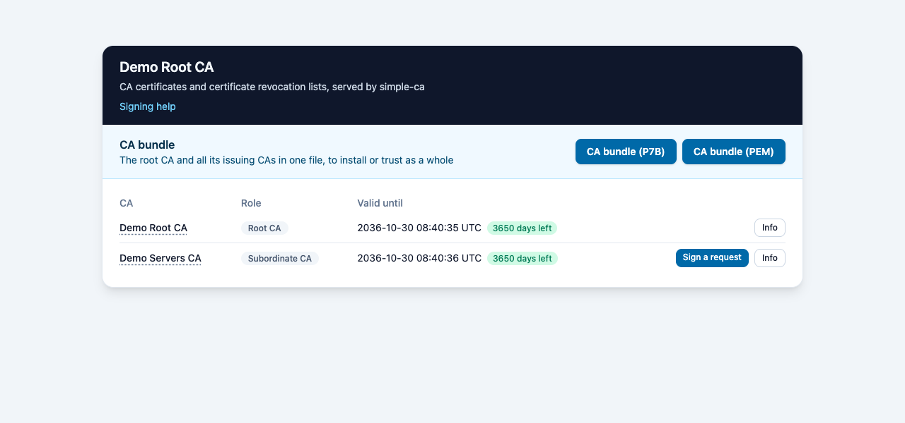

# Simple CA

[](https://github.com/skoszewski/simple-ca/actions/workflows/build.yml)

`simple-ca` creates and manages a simple Certificate Authority for testing and development: a
root CA, issuing CAs, server and user certificates, PKCS#12 bundles, revocation and CRLs. It is a
single executable using Go's native cryptography, and runs no other program. `simple-ca serve`
publishes the CA certificates and CRLs over HTTP, and is an ACME server and a certificate signing
API for the CAs.



The index page of `simple-ca serve` for a root CA and one subordinate CA, `servers`, which signs
requests.

## Installation

Download the archive for your platform from the
[releases](https://github.com/skoszewski/simple-ca/releases) and put `simple-ca` on your `PATH`;
the archive also holds `request-cert`, the Go client of the signing API, `token-setup`, which
exchanges a setup code for its token, `request-token`, which gets the JWTs of workload identity
federation and the access tokens of Google Cloud and Microsoft Entra ID, `simple-ca-wif`, which
sets up Google workload identity federation from the CA host, and `simple-ca-trust`, which adds
the CAs to the trust store. `simple-ca-lite`, with the certificate commands alone, has an
archive of its own, `simple-ca-lite-X.Y.Z-<goos>-<goarch>.tar.gz`.
With Go installed:

```sh
go install github.com/skoszewski/simple-ca@latest
```

An executable installed with `go install` has no `/help/` page of `serve`; the releases have it.

`./build.mjs deb` builds a Debian package with the programs and the systemd units, installed with
`dpkg -i`, and the releases hold it for amd64 and arm64; [systemd](docs/systemd.md#debian-package) describes it.
It also builds `simple-ca-lite`, the package of `simple-ca-lite` alone.

## Quick start

```sh
mkdir -p /tmp/ca
simple-ca ca create --ca-dir /tmp/ca "My Root CA"
simple-ca cert create --ca-dir /tmp/ca web.example.com
openssl verify -CAfile /tmp/ca/ca_bundle.pem /tmp/ca/web_cert.pem
simple-ca serve --ca-dir /tmp/ca
```

The commands are in groups, `ca`, `cert`, `crl`, `token`, `key` and `audit`, and `serve` is a
command of its own;
`simple-ca -h` lists them.

## Documentation

- [Usage](docs/usage.md) - the commands: CAs, certificates, signing requests, PFX bundles,
  revocation, CRLs and encrypted private keys.
- [Directory layout](docs/directory-layout.md) - the files of a CA, their names, and the
  certificate database shared with `openssl ca`.
- [Configuration](docs/configuration.md) - `simple-ca.json`: publish URL, default validity
  periods, certificate types and ACME.
- [serve](docs/serve.md) - the HTTP server of the CA certificates, CRLs and the index page.
- [ACME](docs/acme.md) - the ACME server of `serve`.
- [Signing API](docs/signing-api.md) - tokens, the `/api/sign` API and the signing form.
- [OIDC sign-in](docs/oidc.md) - tokens for the users of a generic OIDC provider, Keycloak or
  Entra ID, given by `oidc-users.json`.
- [Workload identity federation](docs/workload-identity.md) - JWTs of token types that Google and
  Microsoft Entra exchange for their own credentials, issued to tokens with the scope `federate`.
- [Audit log](docs/audit.md) - what changed a CA and who changed it, in `audit.log`, the systemd
  journal and container logs.
- [Signing API clients](docs/examples.md) - the clients in `examples/`, `cmd/request-cert/`,
  `cmd/token-setup/` and `cmd/request-token/`, in Python, Node.js, Go and the shell.
- [Trust stores](docs/trust.md) - `simple-ca-trust`, which adds the CAs to the trust store of
  Windows, macOS or Linux.
- [systemd](docs/systemd.md) - units for `serve` and the daily CRLs.
- [Docker](docs/docker.md) - the container image.
- [Simple CA Lite](docs/simple-ca-lite.md) - `simple-ca-lite`, the `ca`, `cert`, `crl` and `key`
  commands of `simple-ca` alone, in a program and a Debian package of their own.
- [Simple CA Mini](docs/simple-ca-mini.md) - `simple-ca-mini.py`, a single Python 3 script that
  drives the `openssl` command, for the CAs, certificates, PFX bundles and `serve`.
- [Development](docs/development.md) - building, testing and releasing.

The documentation reads in a browser with
[serve-markdown](https://github.com/skoszewski/serve-markdown), also by the author of
`simple-ca`.

## Licence

MIT, see [LICENSE](LICENSE).

`assets/tailwindcss-browser-4.3.3.js` is `dist/index.global.js` of the npm package
`@tailwindcss/browser` 4.3.3, copyright Tailwind Labs, Inc., under the MIT licence of
[assets/tailwindcss-browser-LICENSE](assets/tailwindcss-browser-LICENSE).

The browser files of the `/help/` page, downloaded into `assets/markdown/`, are those of
serve-markdown, bundled with the libraries its `LICENSES.md` names, each under its own licence.
